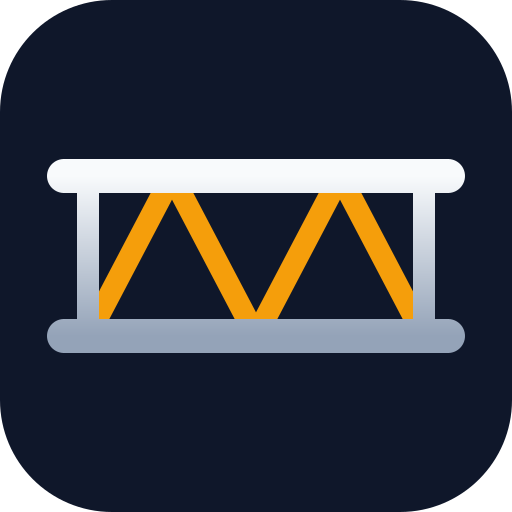

<div align="center">


&nbsp;&nbsp;


# Nivtec kalkulačka pódia

**Zadáš rozmer a výšku, kalkulačka ti povie, koľko čoho treba a ako to postaviť.**

🌐 **[davidbabjarcik.github.io/rigtrack-nivtec](https://davidbabjarcik.github.io/rigtrack-nivtec/)**

*Časť budúcej aplikácie **RigTrack**, ktorá je vo vývoji.*

</div>

---

## Čo to je

Webová kalkulačka pre pódiový systém **Nivtec**. Z rozmerov pódia vypočíta zoznam dielov
a nakreslí pôdorys s rozložením dosiek. Netreba nič inštalovať, beží v prehliadači; prístup majú členovia skupiny.

Pôvodne je to jedna z funkcií aplikácie **RigTrack** (evidencia techniky, kufrov, výpožičiek,
servisu a eventov). Tu je vytiahnutá samostatne pre našu skupinu.

## Čo vie

- 🟫 **Dosky:** rozloženie hlavných aj menších dosiek po 0,5 m, automaticky alebo s otočením podľa teba
- 🦵 **Nohy:** podľa výšky pódia; susedné dosky sa delia o spoločnú nohu
- 🪜 **Schody:** stupne po 20 cm, schodiskové nohy, spojky k pódiu aj zábradlie
- 🎭 **Plachty a štipce:** na zvolené strany, okolo mola aj rizerov
- 🛡️ **Zábradlie:** diely, spojky a rohové spojky
- ➕ **Lišty:** na pero a na drážku, každá na jednu dosku
- 🌀 **Výstuhy („vrtule“)** od výšky 80 cm
- 🛤️ **Molo** (výbežok do publika) a **rizery** (napr. pre bicie, aj na kolieskach)
- 🗺️ **Pôdorys:** kde je pero, ktorou doskou začať stavať, kde idú lišty, plachta a zábradlie
- 📋 **Kopírovanie zoznamu** do správy a **tlač**
- 🔐 **Prihlásenie a skupina:** do aplikácie sa dostanú len pozvaní ľudia; admin pridáva členov a mení roly
- 🧩 **Nivtec diely (len admin):** vlastné rozmery dosiek, nôh, plachiet či príslušenstva, spoločné pre celú skupinu
- 📦 **Sklad:** admin zadá, koľko kusov každého dielu firma má; kalkulačka ukáže, čo chýba, a dosky, ktoré nemáme, nepoužije
- 🌙 Svetlý aj tmavý režim, funguje na mobile

## Čo je nové

### 1.2.1
- Oprava: v Sklade sa diely zdvojovali a nedal sa zadať počet, kým nebolo nastavenie Nivtec ešte ani raz uložené.

### 1.2.0
- **Sklad** v Nivtec dieloch: admin zadá počet kusov každého dielu na firme.
- Kalkulačka má stĺpec **Máme**, vypíše, čo chýba, a menšie dosky s 0 ks nepoužije.
- Odstránené trojuholníky (dosky navyše) a počet nôh pri doske.

### 1.1.0
- Prihlasovacia stránka: prihlásenie, vytvorenie účtu na pozvánku a zabudnuté heslo.
- Skupina s rolami **Admin** a **Člen**, ako v RigTracku: admin pridáva ľudí podľa e-mailu, mení im roly a odoberá ich.
- Podstránky **Kalkulačka**, **Nastavenie** (môj účet, zmena hesla, skupina) a **Nivtec diely**, ktoré vidí len admin.
- Nastavenie dielov Nivtec je spoločné pre celú skupinu a ukladá sa v Supabase.

### 1.0.0
- Prvá samostatná verzia kalkulačky Nivtec vytiahnutá z RigTracku.

## Spustenie u seba

Treba [Node.js](https://nodejs.org/) 22 alebo novší.

```bash
npm install
npm run dev
```

Ďalšie príkazy:

| Príkaz          | Čo robí                                      |
| --------------- | -------------------------------------------- |
| `npm test`      | spustí testy výpočtu aj databázy             |
| `npm run build` | pripraví hotovú stránku do priečinka `dist/` |

## Nasadenie na GitHub Pages

Stránka sa nasadzuje sama cez GitHub Actions (`.github/workflows/deploy.yml`) pri každom pushi do `main`.

1. Nahraj projekt do repozitára na GitHube.
2. V repozitári otvor **Settings → Pages** a ako **Source** vyber **GitHub Actions**.
3. Po dobehnutí akcie bude stránka na `https://<používateľ>.github.io/<repozitár>/`.

## Prihlásenie a Supabase

Aplikácia beží na vlastnom **samostatnom Supabase projekte** (nie na databáze RigTracku).
Dnu sa dostane len člen skupiny:

- **Admin** pridá e-mail človeka v **Nastavenie → Skupina**.
- Ten si na prihlasovacej stránke cez **Mám pozvánku** vytvorí účet s týmto e-mailom.
  E-mail bez pozvánky si účet nezaloží (stráži to databáza).
- **Člen** používa kalkulačku a mení si svoj účet. **Admin** navyše spravuje skupinu a **Nivtec diely**.

### Nastavenie Supabase

1. Na [supabase.com](https://supabase.com) vytvor projekt.
2. V **SQL Editor** spusti po poradí súbory zo [`supabase/migrations`](supabase/migrations):
   `0001_init.sql`, potom `0002_skupina.sql`.
3. Pridaj prvého admina (v SQL Editore, so svojím e-mailom):
   ```sql
   insert into public.members (email, role) values ('tvoj@email.sk', 'admin');
   ```
   Ak už účet s týmto e-mailom máš, prepojí sa hneď. Inak si ho vytvor na stránke cez **Mám pozvánku**.
4. **Authentication → Sign In / Providers:** nechaj **Allow new users to sign up** zapnuté.
   Registrácia je aj tak len na pozvánku, bez nej by si pozvaní nemohli vytvoriť účet.
5. **Authentication → URL Configuration:**
   - **Site URL:** `https://davidbabjarcik.github.io/rigtrack-nivtec/`
   - **Redirect URLs:** pridaj tú istú adresu a pre vývoj `http://localhost:5180/`

   Sem vedú odkazy z e-mailov (potvrdenie účtu, zabudnuté heslo).
6. Z **Project Settings → API** si skopíruj **Project URL** a **publishable (anon) key**.

### Kľúče

Lokálne skopíruj `.env.example` do `.env.local` a vyplň:

```
VITE_SUPABASE_URL=https://xxxx.supabase.co
VITE_SUPABASE_PUBLISHABLE_KEY=sb_publishable_...
```

Pre GitHub Pages sú obe hodnoty priamo v [`.github/workflows/deploy.yml`](.github/workflows/deploy.yml), Secrets netreba.
Pri zmene Supabase projektu ich uprav tam.

> Publishable (anon) kľúč je verejný, je v stránke vidieť a to je v poriadku: dáta chráni RLS.
> **Service role kľúč do stránky ani do GitHubu nikdy nedávaj.**

### Testy databázy

`npm test` spustí aj testy SQL migrácií v [PGlite](https://pglite.dev) (Postgres v Node.js):
registrácia len na pozvánku, roly, posledný admin a spoločné nastavenie.

## Technológie

React 19 · TypeScript · Vite · Tailwind CSS · Supabase · Zod · Vitest

---

<div align="center">

Made with ❤️ by **DejvoLD**

[Instagram](https://www.instagram.com/david.babjarcik/) ·
[Discord](https://discord.com/users/521259942204932096) ·
[LinkedIn](https://www.linkedin.com/in/d%C3%A1vid-babjar%C4%8D%C3%ADk-45814a387/) ·
[GitHub](https://github.com/davidbabjarcik)

© 2026 DejvoLD · Nivtec je značka svojho výrobcu; tento projekt s ním nie je spojený.

</div>
